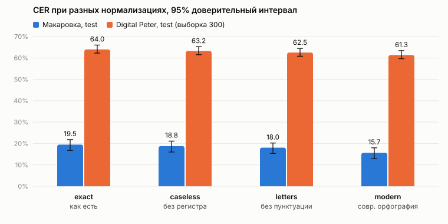
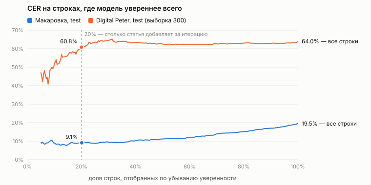
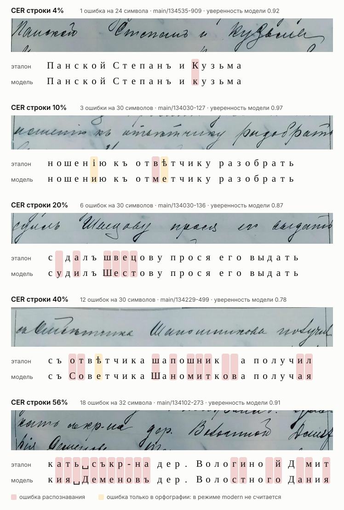
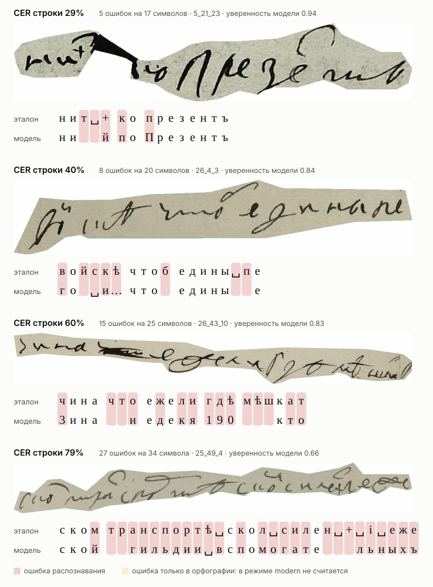

# E001. Готовая модель Kansallisarkisto без дообучения

Дата: 1 ноября 2026. Прогон: `runs/kansallisarkisto-zeroshot/`.

## Зачем

Проверить, можно ли взять готовую открытую модель для рукописной кириллицы и сразу получить
приемлемое качество на наших данных. Заодно это первая точка отсчёта: любая наша модель должна
быть лучше этой.

## Модель

[Kansallisarkisto/cyrillic-large-handwritten](https://huggingface.co/Kansallisarkisto/cyrillic-large-handwritten)
— модель Национального архива Финляндии (проект ArchXAI). Среди открытых моделей, которые мы
нашли, только её учили именно на исторической кириллической рукописи: 56.6 тысячи строк из
архивов Эстонии, Финляндии и Латвии. Это в основном документы времён Российской империи, то есть
близкий к Макаровке жанр. На своём тесте авторы получили CER 4.06% и WER 17.3%.

- Устройство: энкодер DINOv2-large для картинки и декодер ruRoBERTa-large для текста, как в
  TrOCR; 610.6 млн параметров. На вход — строка, растянутая до 182 × 1022 пикселей.
- В разметке, на которой её учили, «ѣ» заменили на «е», а «і» на «и». Поэтому модель пишет
  в современной орфографии, и честнее всего её сравнивать в режиме `modern`.
- Версия весов: `5c56397bde13f550d2ac07a7c7da61c247c17a79`.
- Декодирование — как задано в самой модели: beam search на 4 гипотезы, до 128 токенов, без
  повторов 3-грамм, length penalty 2. От себя мы только включили кэш декодера: на результат это
  не влияет, только на скорость.
- Уверенность строки — среднее геометрическое вероятностей выбранных токенов.

Код обёртки — `src/diploma/models/trocr.py`.

## Данные

- **Макаровка, test**: все 318 строк с 7 страниц.
- **Digital Peter, test**: случайные 300 строк из 1930 (seed 0), со 143 страниц. Весь тест на
  нашем CPU занял бы около 4.5 часов, а для вывода «работает или нет» выборки хватает:
  доверительный интервал получился шириной около 4 п.п.

## Как запускали

```bash
uv run diploma eval diploma.models.trocr:TrOCR -d makarov:test --batch-size 4 --name kansallisarkisto-zeroshot
uv run diploma eval diploma.models.trocr:TrOCR -d peter:test --sample 300 --batch-size 4 --name kansallisarkisto-zeroshot
```

CPU AMD (x86-64, Family 23 Model 96), Windows 11, Python 3.12.0, torch 2.14.1 (CPU),
transformers 5.22.1. Скорость — около 0.12 строки в секунду, на каждый датасет ушло около 45
минут.

Что не зафиксировано:

- в репозитории ещё не было коммитов, поэтому точную версию нашего кода сохранить не удалось;
- прогон Макаровки сделан до того, как в `metrics.json` начали записывать окружение. Версии
  выше те же, прогоны шли на одной машине в один день.

## Результаты

| | строк | CER | WER | без ошибок | CER `modern` |
|---|---:|---:|---:|---:|---:|
| Макаровка, test | 318 | **19.5** (16.8…21.8) | 53.6 | 11.6 | 15.7 (12.9…18.0) |
| — основная колонка | 183 | 19.2 (16.3…21.8) | 50.8 | 7.1 | 16.4 |
| — колонка отметок | 135 | 20.6 (17.7…23.7) | 62.4 | 17.8 | 12.7 |
| Peter, test (выборка) | 300 | **64.0** (62.3…66.0) | 100.1 | 3.3 | 61.3 (59.6…63.4) |

Все числа в процентах, в скобках — 95% доверительный интервал. «Без ошибок» — доля строк,
прочитанных полностью верно.

WER у Peter больше 100%, потому что вставленные моделью лишние слова тоже считаются ошибками.



**Рисунок 1.** CER на обоих датасетах в четырёх режимах сравнения (что прощает каждый режим —
в [validation.md](../validation.md#режимы-сравнения)). Чёрные отрезки — 95% доверительный
интервал бутстрепом по страницам. Данные — `metrics.json` обоих прогонов. Рисунок показывает,
какая часть ошибок приходится на распознавание, а какая — на регистр, пунктуацию и
орфографию.

На Макаровке переход от `exact` к `modern` снижает CER с 19.5% до 15.7%. В эти 3.8 п.п. входят
регистр, пунктуация и орфография вместе; сколько приходится на каждое, показано ниже в разделе
«Из чего складываются ошибки». На Peter все режимы дают примерно одно и то же: там ошибки почти
целиком в чтении.



**Рисунок 2.** Строки отсортированы по уверенности модели, от самой уверенной к наименее
уверенной. По горизонтали — какая доля строк взята, по вертикали — CER на взятых строках. Точка
на 20% — столько самых уверенных предсказаний статья Souibgui et al. добавляет в обучение за
одну итерацию псевдоразметки. Данные — `predictions.jsonl` обоих прогонов: уверенность и ошибки
каждой строки. Рисунок проверяет, можно ли доверять уверенности модели при отборе
псевдоразметки.

На Макаровке уверенность работает: на 20% самых уверенных строк CER 9.1%, на половине — 11.2%,
на всех — 19.5%. Это то же, что заметили авторы статьи: когда модель уверена, она реже
ошибается. Но 9% — всё ещё слишком грязная разметка, чтобы учить на ней как на правильной. На
Peter уверенность почти ничего не даёт: 60.8% на верхних 20% против 64% на всех. Модель, которая
плохо читает, плохо знает и то, где ошибается.

## Как выглядят ошибки

Одно число CER плохо передаёт, насколько текст читаем. Поэтому ниже — настоящие строки из
теста с разным CER.



**Рисунок 3.** Строки теста Макаровки, у которых собственный CER ближе всего к 5, 10, 20, 40 и
60%. Брались только строки длиной от 15 до 38 символов: у короткого обрывка CER скачет от
одной ошибки. У каждой строки — картинка, разметка и ответ модели, выровненные по символам;
красным отмечены ошибки чтения, жёлтым — только орфографические. Данные —
`runs/kansallisarkisto-zeroshot/makarov_test/predictions.jsonl` и картинки из
`data/strings/`; рисунок строит `scripts/report_figures.py gallery`. Он показывает, что стоит
за средним CER модели.

Средний CER модели на Макаровке — 19.5%, это как третья строка: около шести ошибок на строку
в 30 символов. Обычные слова в таком тексте читаются, а фамилии и редкие слова нет: «сдалъ
швецову» → «судилъ Шестову». На 40% искажена уже половина слов («съ отвѣтчика шапошника» →
«съ Советчика Шаномиткова»), на 60% строку не понять даже с подсказкой. Видно и то, что
незнакомое слово модель не читает по буквам, а подставляет похожее знакомое: «дер. Вологиной
Дмит» → «дер. Волостного Дания».



**Рисунок 4.** То же для выборки из теста Digital Peter, уровни 20, 40, 60 и 80%. Средний CER
модели здесь — 64%, то есть типичная строка — третья или четвёртая. Данные —
`runs/kansallisarkisto-zeroshot/peter_test/predictions.jsonl`.

## Из чего складываются ошибки

Каждую правку из выравнивания разметки и ответа отнесли к одной категории: орфография (ѣ → е,
i → и, пропущенный конечный ъ), регистр (та же буква другого регистра), пунктуация и знаки,
пробелы, и всё остальное — неверно прочитанные буквы.

| | Макаровка | Peter |
|---|---:|---:|
| неверно прочитанные буквы | 69.4% | 79.2% |
| ѣ → е | 7.6% | 0.6% |
| i → и | 4.5% | 0.2% |
| пропущенный конечный ъ | 0.6% | 0.2% |
| пунктуация и знаки | 7.2% | 2.3% |
| пробелы | 6.6% | 16.6% |
| регистр | 3.3% | 0.8% |
| прочее (лишний ъ) | 0.9% | 0.2% |
| **всего правок** | 1270 | 5038 |

Ещё две детали. 30 строк Макаровки из 318 модель заканчивает дефисом переноса, которого нет
в нашей разметке: видимо, в архивах, где её учили, была другая договорённость. Канцелярские
формулы она знает хорошо: «по иску кр. с. Макаровскаго» и «къ разбору гражданскаго дѣла»
прочитаны без ошибок; всего таких строк в тесте 37.

## Поможет ли исправление орфографии поверх модели

Модель уже пишет конечный «ъ» (250 раз при 238 в разметке) и окончания «-аго» (8 из 8). При
обучении у неё заменяли только «ѣ» и «і», поэтому ровно их она и не пишет: в её ответах нет ни
одной «ѣ» на 105 в разметке. Всё орфографическое вместе — 12.7% ошибок. Если бы мы исправили
каждую такую ошибку идеально, CER на Макаровке снизился бы с 19.5% до 17.0%. Больше правила
орфографии дать не могут: 69% ошибок — неверно прочитанные буквы, а их исправление орфографии
не трогает.

Для моделей, которые мы учим сами на нашей разметке (CRNN), выигрыш будет ещё меньше: «ѣ» и
«i» есть в их алфавите, и орфографии они учатся вместе с почерком. Словари и тексты в
дореформенной орфографии полезнее в другом качестве — как словарь или языковая модель при
декодировании. Такая модель выбирает из похожих вариантов прочтения существующее слово и
этим исправляет и ошибки чтения. На Digital Peter символьная n-граммная модель снизила CER
CRNN с 5.7% до 3.5% (Potanin et al., 2021).

## Почему на Peter настолько хуже

1. **Другой почерк.** Модель учили на канцелярской скорописи XIX — начала XX века, той же
   эпохи и того же жанра, что Макаровка. Письма Петра написаны на 200 лет раньше, петровской
   скорописью, где многие буквы выглядят иначе (рисунок 4).
2. **Буквы над строкой.** В скорописи XVIII века часть букв выносится над строкой, а в
   разметке Digital Peter они записаны в строку. Модель такого письма не видела, и это одна из
   причин, почему на Peter пропущенные символы — 32% правок против 10% на Макаровке.
3. **Языковые привычки модели.** Когда буквы не узнаются, декодер дописывает то, что часто
   видел при обучении: «транспортѣ» → «гильдии вспомогательныхъ», «iсправит десантъ на
   острофъ» → «и законная жена его Елисавета Маннергеймъ, оба православнаго вероиспо-».
   Последнее — дословный кусок финских архивных документов.
4. **Пробелы.** 17% правок на Peter — пробелы: модель иначе делит слитное петровское письмо на
   слова.

Договорённости разметки (регистр, пунктуация, орфография) разницу не объясняют: в режиме
`modern` CER на Peter всё равно 61%. Разница — в чтении: модель просто не знает этот почерк.

## Выводы

1. Как есть модель не годится: 19.5% CER на Макаровке и 64% на Peter. Заявленные авторами
   4% — это на их собственных архивах; другой почерк и другая нарезка строк дают разрыв в 4–5
   раз даже на близком по жанру материале.
2. Как отправная точка для дообучения на Макаровке модель интересна: она уже читает почерк
   эпохи и знает канцелярский язык. Для Peter её знания почти не помогают.
3. Правила дореформенной орфографии поверх неё дадут не больше 2.5 п.п. (19.5% → 17.0%).
   Основная работа — в чтении букв, особенно фамилий.
4. Уверенность модели осмысленна на данных, похожих на её обучение, — это поддерживает идею
   псевдоразметки из статьи. Но с CER около 20% отбирать псевдоразметку рано: сначала нужна
   модель получше.

## Что дальше

План экспериментов и решения по их итогам — в [plan.md](../plan.md).
