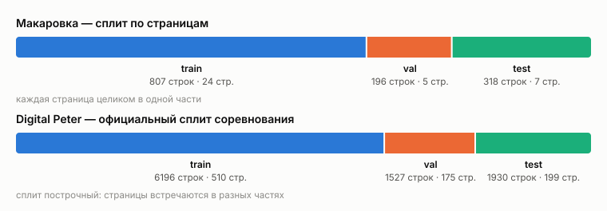
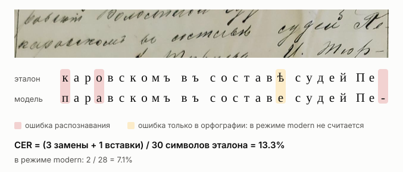

# Валидация моделей

Все модели проверяются одинаково, чтобы цифры разных экспериментов можно было сравнивать. Модель
получает картинку строки и возвращает текст, а этот текст сравнивается с разметкой. Данные,
разбиение на части и формулы метрик для всех моделей общие; как модель устроена внутри, для
оценки неважно. Код лежит в `src/diploma`, запуск — `uv run diploma eval`.

## Данные

| датасет | что это | строк | страниц |
|---|---|---:|---:|
| `makarov` | Макаровский волостной суд, 1913–1914 | 1321 | 36 |
| `makarov-main` | основная колонка страницы | 851 | 36 |
| `makarov-short` | узкая колонка с отметками об объявлении решения | 470 | 30 |
| `peter` | Digital Peter: письма и бумаги Петра I, начало XVIII века | 9653 | 662 |

Обе коллекции — скоропись в дореформенной орфографии: ѣ, i, ъ на конце слов. Почерк и эпоха
разные: у Петра — XVIII век, только строчные буквы и почти без пунктуации. В Макаровке —
канцелярская рука начала XX века, с заглавными, пунктуацией и номерами дел.

В `data/raw/makarovskaya` лежат ещё около 555 фотографий страниц без разметки. В оценке они не
участвуют; это материал для псевдоразметки.

## Разбиение на train, val и test



**Рисунок 1.** Сколько строк и страниц попало в каждую часть. Данные — загрузчики из
`src/diploma/data.py`: для Макаровки разбиение читается из `splits/makarov.json`, для Peter — из
`mapper.csv` соревнования. Рисунок строит `scripts/report_figures.py splits`. Он нужен, чтобы
было видно, насколько маленький у Макаровки тест: 318 строк с 7 страниц.

Макаровку делим **по страницам**: все строки одной страницы целиком уходят в train, val или test.
Строки одной страницы написаны одной рукой, а тексты судебных записей повторяются от дела к делу
(«пилъ къ разбору гражданскаго», «Рѣшенiе объявлено… доволенъ»). Если делить случайно по
строкам, модель видела бы в обучении соседние строки той же страницы, и CER на тесте был бы
занижен.

Разбиение сделано один раз (`diploma split`, seed 0) и лежит в git. Если разметят новые
страницы, загрузчик откажется работать, пока разбиение явно не пересоздадут
(`diploma split --force`). После этого старые и новые цифры на тесте сравнивать нельзя, и это
нужно записать в журнал экспериментов.

У Digital Peter берём **официальное разбиение соревнования**: train → train, public → val,
private → test. Тогда `peter:test` — те же 1930 строк, на которых считались опубликованные
результаты, и с ними можно сравниваться. Но это разбиение построчное: 242 из 662 страниц
встречаются сразу в нескольких частях. Поэтому цифры на Peter получаются чуть оптимистичнее, чем
были бы при разбиении по страницам.

Правило для всех датасетов: решения (гиперпараметры, эпоха, порог уверенности) принимаем по
`val`, а `test` нужен только для итоговых цифр.

## Как считается ошибка



**Рисунок 2.** Одна настоящая строка из теста Макаровки (`main/133601-181`). Сверху — картинка
строки в том виде, в каком её получает модель, вместе с краями соседних строк. Ниже — разметка и
то, что прочитала модель без дообучения из эксперимента [E001](experiments/E001-kansallisarkisto-zeroshot.md),
выровненные по символам. Картинка взята из `data/strings/main/`, предсказание — из
`runs/kansallisarkisto-zeroshot/makarov_test/predictions.jsonl`; рисунок строит
`scripts/report_figures.py example`. Он показывает, что именно считает CER и чем отличается режим
`modern`.

**CER** (character error rate) — минимальное число замен S, удалений D и вставок I символов,
которое превращает ответ модели в разметку, делённое на длину разметки N:

$$\mathrm{CER} = \frac{S + D + I}{N}$$

Это та же метрика, что SER в статье Souibgui et al. и CER в соревновании Digital Peter. Пробелы
тоже считаются символами. Правки и длины суммируются по всем строкам сразу, а не усредняются по
строкам; иначе короткая строка весила бы столько же, сколько длинная.

**WER** — то же самое, но по словам. **Доля строк без ошибок** — сколько строк прочитано
полностью верно.

### Режимы сравнения

Одну и ту же пару «разметка — ответ модели» сравниваем с разной строгостью:

| режим | что прощает | «Рѣшенiе объявлено 5/II, судъ» превращается в |
|---|---|---|
| `exact` | ничего | `Рѣшенiе объявлено 5/II, судъ` |
| `caseless` | регистр | `рѣшенiе объявлено 5/ii, судъ` |
| `letters` | регистр и пунктуацию | `рѣшенiе объявлено 5 ii судъ` |
| `modern` | ещё и старую орфографию: ѣ→е, i→и, ѳ→ф, конечный ъ | `решение объявлено 5 ии суд` |

Главная цифра — `exact`. Остальные режимы показывают, откуда берутся ошибки. `modern` нужен
для готовых моделей, обученных на современной орфографии: им нечестно засчитывать ошибку за
«е» вместо «ѣ». Окончания вроде «-аго» → «-ого» этот режим не исправляет.

### Доверительный интервал

В тесте Макаровки всего 7 страниц, и строки одной страницы зависят друг от друга. Поэтому
разброс оцениваем бутстрепом по страницам: 1000 раз набираем страницы с повторениями, считаем
CER и берём 2.5-й и 97.5-й перцентили. Если интервалы двух моделей сильно перекрываются, то
разницу между ними мы не показали.

### Уверенность модели

Если модель сообщает уверенность, сортируем строки от самых уверенных к наименее уверенным и
считаем CER на верхних 10%, 20%, 50% и на всех строках. На этой проверке держится псевдоразметка
из статьи: там модель размечает неразмеченные строки, и в обучение добавляются самые уверенные
предсказания — 20% от размера трейна за итерацию, с порогом 0.4. Кривая показывает, насколько
грязной будет такая разметка.

### Частые ошибки

Отдельно сохраняется топ-30 замен, вставок и удалений символов. По нему видны систематические
ошибки, например «ѣ → е».

## Подготовка текста

Перед сравнением разметка и ответ модели приводятся к одному виду (`diploma.text.canonical`),
чтобы различия в кодировке не считались ошибками распознавания:

- Unicode NFC: «й» из двух кодов становится одним;
- лишние пробелы схлопываются;
- кириллическая «і» заменяется на латинскую «i», потому что оба датасета размечены латинской,
  а готовые модели обычно пишут кириллическую;
- все виды тире заменяются на дефис;
- латинская буква внутри кириллического слова заменяется на кириллическую. Так исправляется
  «cторонамъ» с латинской «c»; чисто латинские слова у Петра (`piter`, `sire`) не трогаются.

Буквы ѣ, ъ, ѳ, i сохраняются: дореформенная орфография — часть задачи.

## Подключение модели

Модель — любой объект с методом `predict`:

```python
def predict(self, images: Sequence[PIL.Image.Image]) -> Sequence[str | Prediction]: ...
```

На вход приходят цветные картинки строк как есть, на выход — по тексту на каждую, при желании с
уверенностью (`Prediction(text, confidence)`). Масштабирование и декодирование модель делает
сама. Если у модели есть метод `describe()`, его ответ (чекпойнт, версия весов, параметры
генерации) сохраняется вместе с метриками.

```bash
uv run diploma eval diploma.models.trocr:TrOCR -d makarov:test -d peter:test --name <имя прогона>
uv run diploma eval ... -d peter:test --sample 300 --seed 0   # случайные 300 строк
uv run diploma compare                                        # таблица по всем прогонам
```

## Где лежат результаты

Каждый прогон пишет в `runs/<прогон>/<датасет>/` два файла:

- `predictions.jsonl` — для каждой строки разметка, ответ модели, уверенность и CER;
- `metrics.json` — все метрики, а также что запускали: модель и её аргументы, версия весов,
  выборка и seed, версии Python, torch и transformers, процессор, git-коммит, время работы.

Папка `runs/` хранится в git. Каждый эксперимент описан в
[`docs/experiments/`](experiments/README.md), там же журнал.

## Известные проблемы разметки

- На странице `134026` (val) 11 строк размечены дважды: это одни и те же строки, вырезанные два
  раза (`main/134026-97…103` и `428…434`, `short/134026-108…115` и `440…447`).
- На странице `133601` (test) строка `main/133601-0` повторяет `main/133601-183`.
- В `main/133710-272` в слове «cторонамъ» стоит латинская «c»; её исправляет подготовка текста.
- 41 строка Digital Peter не входит ни в одну часть официального разбиения, мы её не загружаем.

Дубли пока не удалены: в тесте это одна лишняя строка из 318.
